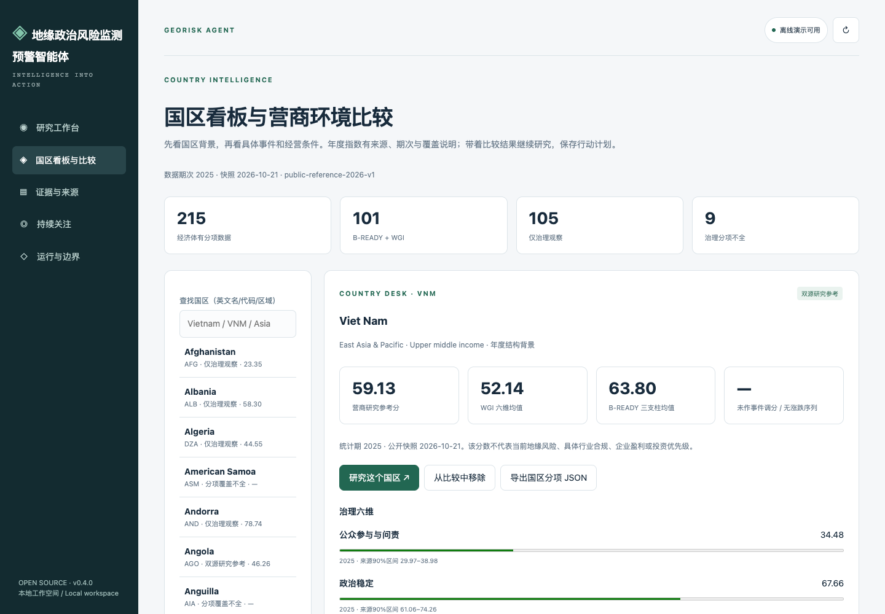
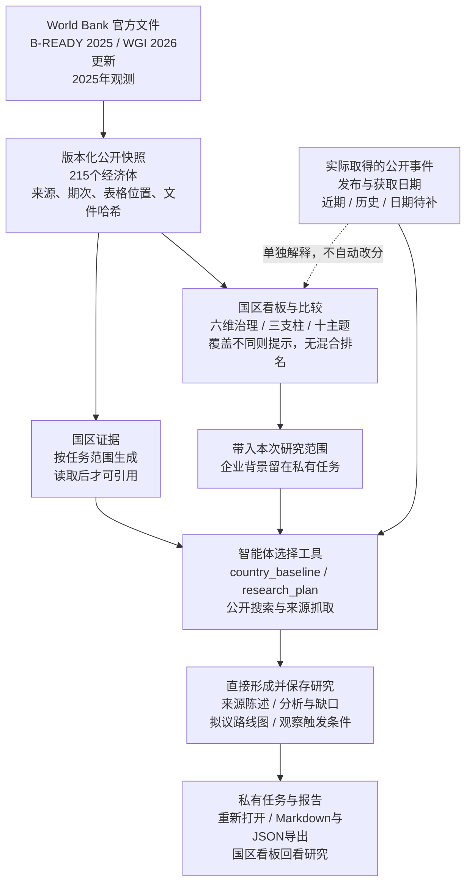
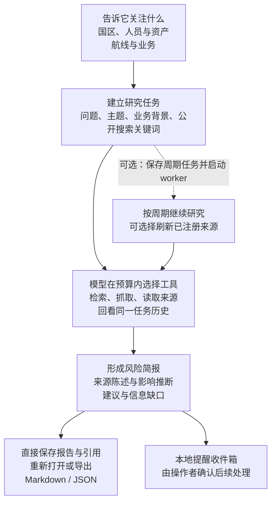
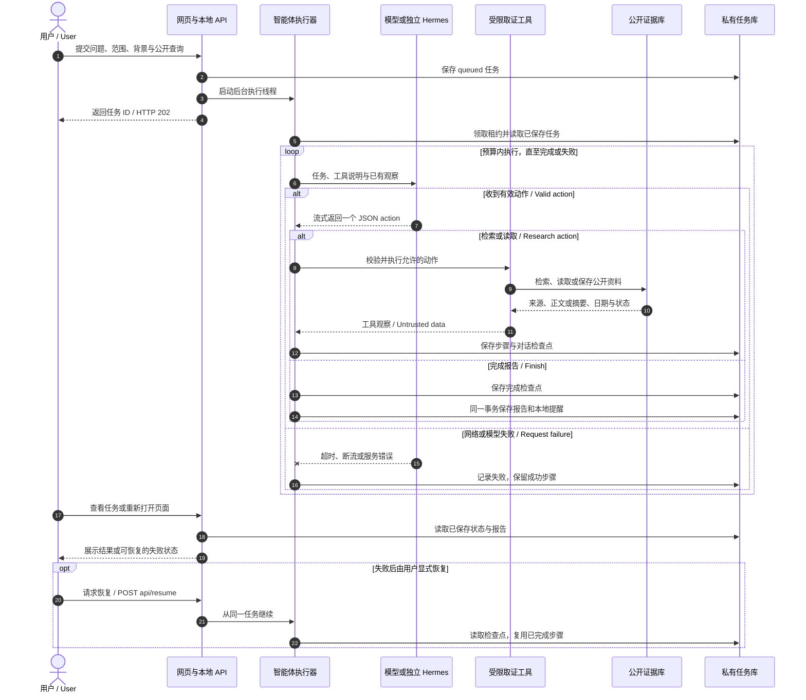
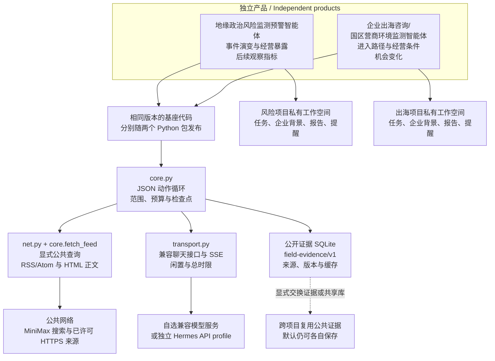

# 地缘政治风险监测预警智能体

从一个国际问题出发，查资料、理清事件与各方立场，形成带来源的分析，再接着跟踪会改变判断的新进展。

GeoRisk Agent · [English guide](#english-guide) · [中文完整说明](README.zh-CN.md) · [先跑示例](#try-it-in-two-minutes) · [正式版本 / Release](https://github.com/workstonedai-collab/georisk-agent/releases/tag/v0.13.0)

[](https://github.com/workstonedai-collab/georisk-agent/actions/workflows/ci.yml)
[](LICENSE)
[](pyproject.toml)
[](docs/roadmap.md)

国际问题的资料往往并不少。新闻、声明、报告和论文散在不同地方，同一件事也可能有几种说法。真正费时间的是把它们放回时间和背景中：发生了什么，各方为什么这样做，不同解释各有什么依据，下一步出现什么变化，才值得重新判断。

这个项目把资料、分析和后续问题保存在同一个可以接续的研究任务里。你可以带着一个具体问题开始，也可以围绕某个国家、地区、国际组织或长期议题持续跟踪。智能体在你允许的范围内检索公开信息、阅读材料，整理来源陈述、分析判断与信息缺口，直接形成并保存报告。之后继续提问时，可以接着已有资料和判断往下做。

它面向国际关系、国际政治、区域国别、国际组织和全球治理研究者，也面向咨询公司、律所等专业服务从业者、国际记者、国际问题爱好者，以及有海外利益的企业和个人。研究一个议题、准备一篇报道、评估一项利益可能受到的影响，关注点各不相同；你可以按本次任务选择入口，研究和报道任务不必填写企业背景。

## 可以这样使用

**专题研究：围绕一个问题，把解释和依据展开。** 比如研究某个国际组织中的立场变化，可以让它梳理相关行为体、声明和事件顺序，比较材料所支持的解释，说明分歧在哪里、哪些问题还需要进一步找资料。这个入口适合研究讨论和专题准备；是否能覆盖所需文献，取决于实际接入和取得的资料。

**事件跟踪与报道准备：先看新增了什么，再看哪些仍待核实。** 围绕一次选举、一轮谈判或一项政策变化，你可以要求它整理时间线，保留原始声明与转述的归属，列出不同说法和进一步取材的问题。采访问题供后续取材使用，不代表已经完成采访或独立核实。

**利益影响与风险观察：把事件放回与你有关的处境里。** 新闻每天都有，难的是判断哪条与你有关：一项制裁是否涉及合作方，一次港口限制会不会影响交付，一场局势升级是否已经触及当地团队。提供相关人员、资产、航线、项目或其他利益后，可以围绕影响路径、关键条件和下一次观察信号展开分析。事件与某项业务的关联不明时，报告应保留这个条件。

## 把研究接着做下去

例如，持续研究某个国际组织中的立场变化时，可以把历次声明、研究笔记和背景报告整理成一个知识库，选入当前任务，再结合允许检索的公开资料比较各方解释。报告保存后，把仍需观察的问题设为持续关注；新材料到来时，接着原来的问题研究，回看哪些依据或判断需要调整。

你提供的材料可以在“我的知识库”里按项目整理：上传文件、查看解析状态，再选择本次研究使用哪些资料。原件、版本与出处留在私有工作空间，更新资料后仍能追溯旧任务。

材料入库后，可以先试查内容，再决定本次研究使用哪些资料。引用保留文档版本与可取得的出处位置；替换材料后，已初始化的任务仍沿用原版本。扫描件需要另行处理，Office 的文字转换也不能代替对原件排版、表格和注释的阅读。

希望持续关注时，先保存监测方案，预览并确认范围、提醒标准和检查/汇总频率，再启动工作进程。事件风险、长期议题和经营机会分别设置；没有新增内容时保持安静。需要飞书等渠道时，可显式接入已有 Hermes 发送配置。

提醒标准可以围绕你的研究问题设置：关注哪些行为体、哪些声明或事件，什么变化值得重新研究，哪些消息只作背景。检查来源与汇总快报可以采用不同频率，也可以设置免打扰时段、首次只建立基线。规则模式按明确词项和来源筛选；需要按文字标准研判时，选择有预算的模型模式。方案、来源配置或外部接收位置发生变化后，需要重新预览并确认。

项目还可以按你的选择积累研究经验：本地整理有效步骤与纠正，或在独立额度内让模型提炼技能候选。技能保留来源任务与版本，可以启用、停用和回退；不会自动扩大工具权限或公开你的资料。[知识库、持续监测与技能学习说明](docs/continuous-research.md)

比如，你可以明确纠正“先区分原始声明与媒体转述，再比较解释”，让这条要求进入本项目的技能候选。默认由你选择版本启用；以后也能停用或回退。学习在报告保存后另行处理，本地整理不增加模型调用，模型提炼使用单独限额；它积累的是研究步骤与使用经验，不更新基础模型权重。

一次研究结束后，你可以回看报告、来源和工具记录，也可以补充本机资料，沿着尚未解决的问题继续查。研究记忆把来源陈述、假设、判断、拟议方案和你的决定分开保存，保留修订原因；旧判断供本次研究参考，新的输入优先。周期跟踪需单独启动工作进程，新进展和相关提醒先保存在本地，由你决定怎样使用。

成果可以保存为 Markdown、JSON，也可以通过可选的本地 OfficeCLI 导出成可编辑 Word，继续用于讨论或工作材料。已有 Word、Excel、PowerPoint 可通过可选文档适配器导入；转换保留文本及出处信息，复杂排版和表格仍需对照原件。接入自己的工具时，可使用默认只读的本地 MCP 接口。[研究记忆](docs/research-memory.md) · [办公资料与任务入口](docs/office-and-tasks.md) · [MCP 接入](docs/mcp.md)

如果你不熟悉编程，可以把这个仓库交给自己的 Agent，让它按说明部署，先跑无需密钥的演示，再带你配置模型、公开搜索和信息源。可以独立使用，也可以与[企业出海咨询/国区营商环境监测智能体](https://github.com/workstonedai-collab/market-entry-agent)交换公共证据。企业背景、研究任务和报告仍保存在各自的私有工作空间。

**开放范围与交流：** 国区评分配方、分项权重、贡献计算与通用研究步骤已公开。部分进一步的研究方法、专用提示词和相关知识内容暂未开源。如有需要或希望进一步交流，欢迎[联系作者](https://github.com/workstonedai-collab)或提交[项目 Issue](https://github.com/workstonedai-collab/georisk-agent/issues/new)；私人资料请勿直接发布在公开 Issue。

当前正式版本为 **v0.13.0**。可自行部署，项目仍处于 Alpha 阶段；离线演示无需模型密钥，真实研究需配置模型与来源。

<a id="english-guide"></a>

# GeoRisk Agent

A research agent for understanding international affairs and following how an assessment changes over time. Start with a question about a country, region, international organization or wider issue. The agent searches within your permitted public scope, reads available material and saves an analysis that distinguishes source statements, interpretation, open questions and next steps.

## See the workspace



This is the country dashboard, not a completed assessment for an arbitrary business. Use the demo below to inspect saved results; [public examples](examples/README.md) explain which inputs are fictional or attributed public data.

## Try it in two minutes

Python 3.11+ required. No model key, external service or paid account is needed for the offline demonstration.

```bash
git clone https://github.com/workstonedai-collab/georisk-agent.git
cd georisk-agent
python3 -m venv .venv
source .venv/bin/activate
python -m pip install -e .
georisk-agent demo
georisk-agent serve
```

Open **http://127.0.0.1:8711**. Inspect the saved brief, source records and tool trace. Choose a mission, run it again, or export the result as Markdown/JSON.

The demo uses **fictional scenarios and a deterministic policy**. Its interface and exports are labeled accordingly. It demonstrates the execution and storage path, not the quality of an LLM or real-time intelligence.

For native Windows, use PowerShell without activation:

```powershell
py -3.11 -m venv .venv
& ".\.venv\Scripts\python.exe" -m pip install .
& ".\.venv\Scripts\python.exe" -m georisk_agent demo
& ".\.venv\Scripts\python.exe" -m georisk_agent serve
```

See the [Windows installation, model configuration and troubleshooting guide](docs/windows.md). CI exercises Python 3.11–3.13 on Windows, macOS and Linux, plus a clean PowerShell installation. The package is installed from this repository or its release wheel; no PyPI publication is claimed.

## Background and open scope

Build named private knowledge collections from your files, then select them for a project task. Draft and preview a watch, confirm its scope, criteria and check/digest cadence, and run a separate worker. Optional procedural learning turns completed tool paths and explicit corrections into private, versioned skills; activation and rollback remain visible. Model distillation has its own opt-in daily budget. [Setup and limits](docs/continuous-research.md).

For a study of changing positions within an international organization, collect earlier statements, research notes and background reports in a private library. Select it for the task and compare explanations against permitted public sources. Once the report is saved, turn an unresolved question into a watch and return to the existing research when new material arrives.

Search imported material before selecting it for a task. Citations retain document versions and available source locations; replacing a file leaves initialized tasks on their saved version. Scanned documents need separate processing, and Office text conversion still requires checking complex tables and layout against the original.

Set watches around the actors, statements and developments relevant to your question. Separate checking from digest delivery, set quiet hours and choose whether the first check only establishes a baseline. Rules mode uses explicit terms and sources; model mode uses your written criteria within a research budget. Changes to the watch, source configuration or external destination require preview and confirmation again.

A correction such as “distinguish original statements from media retellings before comparing explanations” can become a private skill candidate. You choose which version to activate, disable or restore. Learning runs after the report is saved: local extraction adds no model calls, while model distillation has a separate allowance. It develops reusable procedures without training the underlying model.

A research agent for understanding international affairs and following how an assessment changes over time. Start with a question about a country, region, international organization or wider issue. The agent searches within your permitted public scope, reads available material and saves an analysis that distinguishes source statements, interpretation, open questions and next steps.

It serves researchers in international relations, international politics, area studies, international organizations and global governance; consultants and legal professionals; international journalists; interested readers; and businesses or individuals with overseas interests. Topic research and reporting preparation do not require company context.

Choose **topic research** to examine actors, positions, possible explanations and the evidence behind them. Choose **event tracking and reporting preparation** to follow a timeline, distinguish original statements from retellings and identify what still needs checking. Choose **interest and risk monitoring** to examine how a development may affect the people, assets, operations or other interests you explicitly supply. These are available task contracts, not a claim that every topic or source is covered.

Continue with the same project to retain read material, hypotheses, judgments and your own decisions with their revision history. Reports and source records remain available for reopening and export. Recurring work requires a separately started worker; notifications enter a local inbox. Optional local adapters import DOCX/XLSX/PPTX and export the complete saved report as editable Word without another model call. [Task and Office guide](docs/office-and-tasks.md).

**Open scope and contact.** The country-reference formula, component weights, contributions and general research steps are public. Some additional research methods, specialized prompts and associated knowledge resources are not open source at this time. For further discussion, [contact the author](https://github.com/workstonedai-collab) or open a [project issue](https://github.com/workstonedai-collab/georisk-agent/issues/new) without posting private material.

Initial drafting uses a versioned writing skill to explain event changes, possible business effects and what to watch next. Source retrieval status is available alongside the evidence. See [report writing and case evaluation](docs/report-quality.md).

Research questions, exact source fragments and next steps can now be saved and resumed. Optional public-term search composition and local text/CSV imports extend the existing tools. PDF text extraction requires a separately configured adapter and does not include OCR; the base runtime has no added dependencies. [Research-state guide](docs/research-state.md).

Three additional historical cases can be run individually to inspect the agent’s direct output: `rubymar-route`, `true-confidence-crews`, `panama-booking`. Inputs, returned JSON actions and raw reports are retained privately for comparison. [Case instructions](docs/report-quality.md#用几组真实事件检查直接生成的原稿).

## Continue the business project

Keep the people, assets, routes or operations you care about in a private project, then follow each event as new sources arrive. Changes in severity, status, evidence strength or business impact create local alerts; summary-only edits and repeated sources stay quiet. Each alert retains source dates, the affected exposure and what to watch next.

Add an exposure, save an event, or continue research from the project desk. Local comparison uses saved records only. To obtain new information, run research, refresh registered sources or start a configured worker. You can record whether an alert was useful and how it was handled.

[Workflow guide and public replay](docs/product-workflow.md) · [Case sources](examples/public-project-case.json)

### Follow the operating exposure

Record routes, ports, suppliers and projects with explicit object IDs, importance and deadlines. Compare sourced events with those records and inspect the reasons for attention order. Confirmed aliases and dossier merges preserve original histories; changes in business exposure can be checked again. See [risk decision paths](docs/decision-paths.md).

## Questions to bring to the agent

| Example question | Useful context | Research output to look for |
|---|---|---|
| Could a route disruption affect our next delivery? | Route, countries, shipment assumptions, research date and permitted public queries | Event development, possible exposure, gaps and observable watchpoints |
| Does a new restriction warrant checking a business partner? | Relevant countries, product or activity, policy text and specific question | Scope to investigate, cited sources and issues requiring specialist verification |
| What should our local team check next? | Countries with people or assets, topics and existing public evidence | Task-specific implications, unanswered questions and a follow-up checklist |

These are example questions, not findings about current events. Try the [fictional mission](examples/mission.json) or the [public country-data mission](examples/public-data-mission.json); neither includes customer information.

## Published research steps

The public outline follows **event and change → business exposure → structural country background → observation and response**. `research_plan` supplies the outline; reports may save observable `watchpoints` and proposed action stages. A custom mission can require `watchpoints` or `roadmap` in `output_sections`. These fields describe proposed follow-up, not actions already taken.

## A country desk, from background to action

Explore **215 economies with governance observations**, including **101 with both B-READY and WGI**. View six governance dimensions, three business-environment pillars and ten business topics; compare up to five countries, inspect source periods and continue into a research mission. The desk also shows public evidence actually collected in the workspace and previously saved country research.

Market-entry research can cover macro conditions, industry, competitors and entry routes, then save proposed roadmap stages. Risk research can save business exposures and observable watchpoints. Both extensions persist with reports and exports. The 60% B-READY / 40% WGI synthesis is a **research reference**, with WGI-only and incomplete coverage clearly separated. No mixed-basis ranking or automatic event-driven score movement is generated.

The bundled snapshot uses B-READY 2025 and WGI 2026 Update observations for 2025, retrieved on 2026-10-21. [Country desk and method](docs/country-dashboard.md) · [Data attribution](LICENSE-DATA.md).




<a id="workflow"></a>

## Workflow and technical route

Start with a scoped question. The model chooses tools within the action and time budgets, reads the available material and saves a sourced report. These diagrams use the Chinese product names and bilingual runtime labels.



Recurring research requires a separately started worker. Reports save directly; confirming an inbox item changes only its local notification state.

<details>
<summary>Execution sequence and shared technical foundation</summary>

### Submission, research and recovery

The web API returns a task ID immediately. Research continues on the server, with each completed tool step checkpointed. You can reopen the page or explicitly resume a failed run.



The configured model receives the mission, business context and selected evidence. Public search receives only explicit public queries or combinations of operator-approved public terms. Source content is treated as data rather than instructions.

### Shared code, independent workspaces

The repositories install and release independently. They vendor the same versioned core and use the `field-evidence/v1` evidence contract. Public evidence exchange or a shared evidence database is an explicit operator choice.



The shared foundation denotes code distributed inside each package. Private missions, company context, reports and notification state stay in separate workspaces; selected material is transmitted to the configured model endpoint.

</details>

## Continue a project across research tasks

Give related missions an explicit `project_id`. Save operator-owned facts, recall related reports, load document skills on demand and inspect model-call receipts. Current task input takes precedence; private context stays in the workspace and goes only to the configured model. Public search receives only explicit queries or approved public-term combinations.

```bash
georisk-agent memory-set fictional-research product "Synthetic equipment export case"
georisk-agent demo --project fictional-research
georisk-agent run examples/project-mission.json --engine demo
georisk-agent skills
```

Model context uses a configurable character budget and saved-result references. Pause/cancel controls settle at safe boundaries; failed attempts retain completed steps and a model-call limit across resume. [Full guide: memory, context, tools, skills and recovery](docs/kernel.md). Windows uses the same commands through its venv Python.

### Continue research with typed memory

Source statements, hypotheses, judgments and proposed decisions stay distinct across runs of an explicit project. Context selection uses the current question and critical constraints, retaining relevant opposing evidence. Operators can record decisions, inspect revisions and remove memory; resumed runs retain their frozen context. Previous analysis never becomes newly read evidence. See [research memory and context](docs/research-memory.md).

## Use a model and your evidence

Set an explicit chat-completions endpoint. A dedicated [Hermes API profile](docs/hermes.md) is supported through its compatible endpoint; other compatible local or hosted models can use the same JSON-action protocol.

```bash
export AGENT_MODEL_BASE_URL=http://127.0.0.1:8642/v1
export AGENT_MODEL_NAME=dedicated-research-profile
export AGENT_MODEL_API_KEY=your-own-gateway-key

georisk-agent --workspace ./workspace import your-evidence.json
georisk-agent --workspace ./workspace run examples/mission.json --engine model
georisk-agent --workspace ./workspace serve
```

Evidence can be deliberately imported or retrieved through registered sources and explicit public search queries. Model mode sends the mission, business context, retrieved evidence and summaries of earlier runs for the same mission to the configured endpoint. It does not discover local credentials or read other projects.

### Refresh public feeds

Register your permitted RSS/Atom feeds using the configuration described in [the evidence guide](docs/evidence.md), then let the model select `fetch_feed`, or refresh one explicitly:

```bash
georisk-agent sources your-sources.json
georisk-agent fetch your-source-id
```

The public runtime supports MiniMax public web search and bounded HTML page retrieval alongside registered feeds and local evidence search. See [live research](docs/live-research.md) for configuration and data boundaries. Country and topic tags on feeds are operator-supplied. Source claims remain claims until a human verifies them.

### Bring your own research instructions

The public package includes generic role instructions, the published research outline and report schemas. Set `AGENT_INSTRUCTIONS_FILE` to an explicit UTF-8 file outside the repository, up to 24KB, to add your own instructions. Its contents go to the configured model and persist in local checkpoints. Resuming uses the saved instructions; start a new mission to apply changes. See [model, search and data boundaries](docs/live-research.md).

## What the agent can do

| Capability | Current behavior |
|---|---|
| Model-directed research | One JSON action per turn; the model selects documented, bounded tools |
| Evidence | Content-addressed revisions, original links, claim status and two timestamps |
| Memory | Project facts, source statements, hypotheses, judgments, proposed decisions and operator decisions retain their provenance; context is selected for the current question and frozen per attempt; legacy same-mission recall remains available without a project ID |
| Recovery | Save steps and model context; retry a failed run without repeating saved steps |
| Monitoring | Confirmed event/topic/operating watches with separate check and digest cadence, meaningful-change records and recovery; a separate worker executes them |
| Delivery | Save reports immediately; export Markdown/JSON; local inbox by default, optional explicitly confirmed Hermes destination with receipts |
| Interfaces | CLI, browser workspace, loopback HTTP API, opt-in local MCP stdio adapter and container recipe |
| Knowledge libraries | Selected project collections retain original files, versions and source locations; local retrieval and index rebuilding stay in the private workspace |
| Procedural skills | Opt-in local extraction or separately budgeted model distillation, with visible candidate versions, activation, disabling and rollback |

Available tools: `country_baseline`, `research_plan`, `search_evidence`, `read_evidence`, `recall`, `list_sources`, `fetch_feed`, `web_search`, `fetch_page`, `finish`, `load_skill`, `read_result`, `project_state`. Saved-research tools add `research_state` and `update_research`; optional public-term composition adds `adaptive_search`, while research depth adds `research_branch` and `close_branch`. Tools are exposed only when their prerequisites are configured. There is no model-generated shell execution. Finding citations must reference records the agent actually read. This validates provenance, not the truth of every model statement.

## Keep a mission running

```bash
georisk-agent schedule examples/mission.json --engine model --interval 3600
georisk-agent worker --once
# For continuous execution, run this under your own process supervisor:
georisk-agent worker
georisk-agent schedules
georisk-agent outbox
```

Creating a schedule does not start a background service. Model runs may choose to refresh registered feeds; a schedule does not force every source to refresh. New evidence revisions create a new local notification; unchanged evidence for the same mission is deduplicated. Legacy schedules remain local; new confirmed watches can opt into a separately configured Hermes destination. See [continuous research](docs/continuous-research.md). See [runtime and recovery](docs/runtime.md).

## Two agents, interoperable evidence

[market-entry-agent](https://github.com/workstonedai-collab/market-entry-agent) is an independent product with different research goals. Both use the versioned `field-evidence/v1` contract and identical vendored runtime code. Export/import public evidence bundles or explicitly point both at the same public evidence database. Keep company context, task history and reports in separate private workspaces. See [shared core](docs/shared-core.md).

## Self-host and develop

```bash
python -m unittest discover -s tests -v
python scripts/check_core.py
docker build -t georisk-agent .
docker run --rm georisk-agent demo
```

For persistent serving, authentication, workers and reverse proxy setup, see [deployment](docs/deployment.md). GitHub hosts the code and releases; it does not operate a live monitoring service for you.

## Tools and Office files

### Connect tools and choose research depth

Expose saved tasks, reports and project state through an opt-in [MCP stdio adapter](docs/mcp.md), read-only by default. Explicit startup permission enables bounded task execution. Operator-configured outbound MCP search receives public queries only. [Optional research branches](docs/research-depth.md) retain separate question paths inside the same run and budgets; document skills describe inputs, outputs and tool needs without granting permissions.

### Office files and task-focused research

Choose a task in the browser or CLI: geopolitical topic research, event/reporting preparation or interest monitoring; market options, transaction review or operating-premise monitoring. Optional MarkItDown imports local DOCX/XLSX/PPTX, while a local iOfficeAI/OfficeCLI adapter exports the complete saved report as editable DOCX without another model call. [Setup and boundaries](docs/office-and-tasks.md) · [Integration references](docs/integration-references.md).

## Scope and next steps

This is a **single-operator, self-hosted alpha**. Current limitations: no hosted tenant system, default external messaging, guaranteed event coverage, calibrated forecasts, commercial country index or autonomous transaction execution. Automated contract tests cover recovery, citations, search boundaries and streaming failures. See the [roadmap](docs/roadmap.md) and [security boundaries](SECURITY.md).

Code is MIT licensed. World Bank observations retain their own attribution and terms in [LICENSE-DATA.md](LICENSE-DATA.md). Contributions with reproducible public or synthetic examples are welcome.


## Release and evaluation history

[当前正式版本 v0.13.0](https://github.com/workstonedai-collab/georisk-agent/releases/tag/v0.13.0) · [完整更新记录](RELEASE_NOTES.md) · [报告案例与实际限制](docs/report-quality.md)

Recent releases connect incoming material, everyday research tools and continued project work:

| Release | What changes in use | Guide |
|---|---|---|
| v0.13.0: private libraries, watches and procedural skills | Import files, preview and confirm monitoring, and choose whether to generate, activate or roll back private skills | [Setup, recovery and limits](docs/continuous-research.md) |
| v0.12.0–v0.12.1: Office files and task entry points | Choose a task, optionally import Office material or export a complete Word report; Windows test cleanup waits for file handles to close | [Office and tasks](docs/office-and-tasks.md) |
| v0.11.0: tool integration and question branches | Read saved research through MCP, explicitly enable task execution, and investigate separate questions within the original task budget | [MCP](docs/mcp.md) · [Research branches](docs/research-depth.md) |

The v0.13.0 installed-package checks exercised library creation, report saving and reopening, watch confirmation and skill generation. Cross-platform checks continue on macOS, Windows and Linux. Scripted substitutes cover the new model branches and Hermes receipts; real-model report cases and their limits remain documented in the case guide linked above.

<details>
<summary>Earlier v0.11.0 product paths and evaluation</summary>

## v0.11.0: connect an event to the business it may affect

The [release and installation packages](https://github.com/workstonedai-collab/georisk-agent/releases/tag/v0.11.0) are available. Continue following an event against the routes, ports, suppliers or projects you have recorded.

Save a business object's importance and key dates, then link a sourced event to it. The project retains earlier assessments and explains why an alert is relevant and what deserves attention first. When both records have explicit object IDs, they match through shared IDs; without them, the result is labeled as a country or topic match. Operator-confirmed aliases and dossier merges preserve the original history. See [risk decision paths](docs/decision-paths.md).

Follow-up research keeps source statements, hypotheses, judgments and proposed decisions separate. Context selection brings forward material relevant to the current question, including opposing evidence. Your decisions retain their own revision history, and current input takes precedence. Saved source excerpts, open questions and next steps help continue interrupted work. [Research memory](docs/research-memory.md) · [Saved research state](docs/research-state.md)

An optional [local MCP adapter](docs/mcp.md) lets your client read saved work; task creation and recovery require explicit startup permission. [Question branches](docs/research-depth.md) follow separate lines of inquiry within the same task and budgets. Public search uses only approved queries or term combinations, without adding private business context.

This version was exercised with MiniMax on historical Rubymar material and fictional business conditions, including direct report output, business matching and saved-report reopening. A format failure required recovery from the original response. The report prose was not manually polished; see [case results and limits](docs/report-quality.md#v0110-产品路径验收).

</details>
