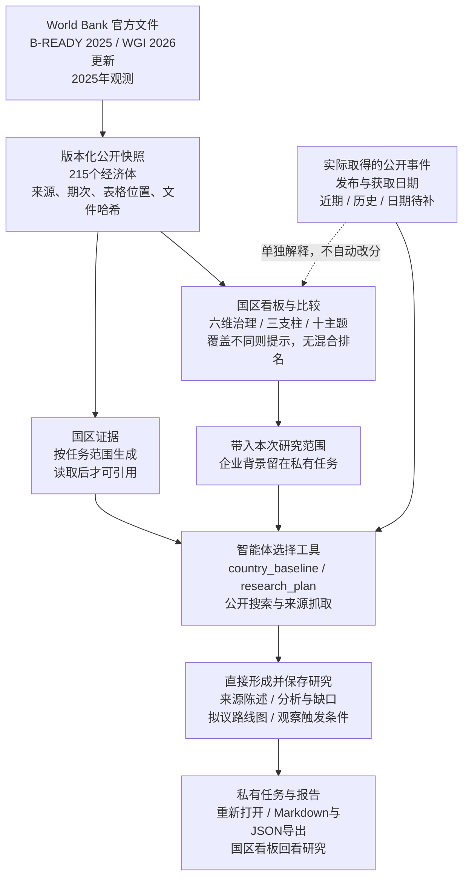
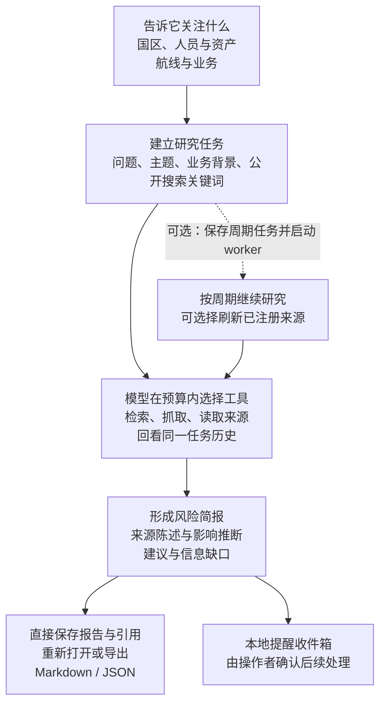
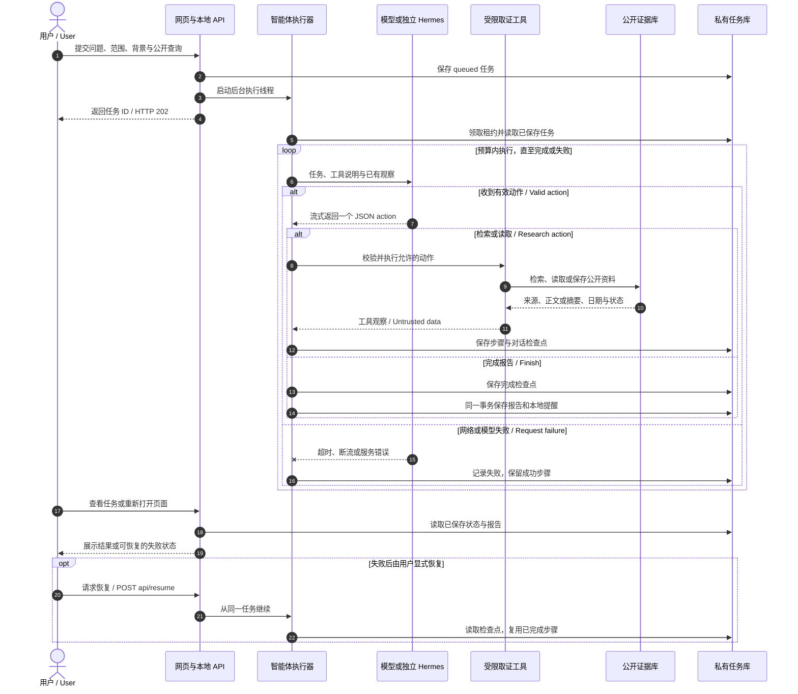
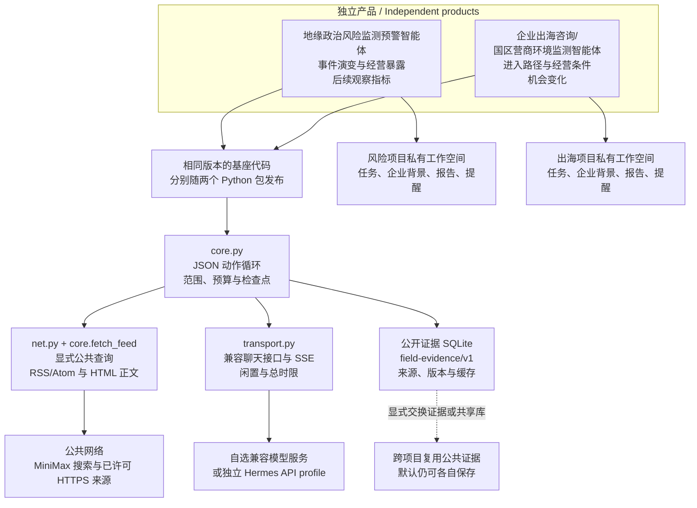

# 地缘政治风险监测预警智能体

给关注海外人员、供应链和经营资产的团队使用。输入关注地区、事件和业务背景，得到带来源的风险简报、可能影响和后续观察清单。

[中文说明与上手](README.zh-CN.md) · [Quickstart](#try-it-in-two-minutes) · [Public examples](examples/README.md) · [Live research](docs/live-research.md)

# GeoRisk Agent

[](https://github.com/workstonedai-collab/georisk-agent/actions/workflows/ci.yml)
[](LICENSE)
[](pyproject.toml)
[](docs/roadmap.md)

For teams tracking overseas people, shipments and assets. Describe the countries, events and business exposure you care about to build a sourced brief with possible impacts, gaps and indicators to watch.

**Self-hosted alpha.** The offline demo uses fictional evidence and needs no model key. Live research requires a configured model and sources.

## See the workspace


This is the country dashboard, not a completed assessment for an arbitrary business. Use the demo below to inspect saved results; [public examples](examples/README.md) explain which inputs are fictional or attributed public data.

## Try it in two minutes

Python 3.11+ required. No model key, external service or paid account is needed for the offline demonstration.

```bash
git clone https://github.com/workstonedai-collab/georisk-agent.git
cd georisk-agent
python3 -m venv .venv
source .venv/bin/activate
python -m pip install -e .
georisk-agent demo
georisk-agent serve
```

Open **http://127.0.0.1:8711**. Inspect the saved brief, source records and tool trace. Choose a mission, run it again, or export the result as Markdown/JSON.

The demo uses **fictional scenarios and a deterministic policy**. Its interface and exports are labeled accordingly. It demonstrates the execution and storage path, not the quality of an LLM or real-time intelligence.

For native Windows, use PowerShell without activation:

```powershell
py -3.11 -m venv .venv
& ".\.venv\Scripts\python.exe" -m pip install .
& ".\.venv\Scripts\python.exe" -m georisk_agent demo
& ".\.venv\Scripts\python.exe" -m georisk_agent serve
```

See the [Windows installation, model configuration and troubleshooting guide](docs/windows.md). CI exercises Python 3.11–3.13 on Windows, macOS and Linux, plus a clean PowerShell installation. The package is installed from this repository or its release wheel; no PyPI publication is claimed.

## Background and open scope

<details>
<summary>Research use cases, ongoing work and contact</summary>

一个帮你持续关注地缘政治变化、判断业务影响，并留下证据的研究智能体。你可以告诉它关注哪些国家和地区、哪些人员与资产、哪些航线和业务，它会检索公开信息，阅读相关材料，整理事件进展，给出风险简报和后续观察清单。

新闻每天都有，难的是判断哪条与你有关：一项制裁是否涉及合作方，一次港口限制会不会影响交付，一场局势升级是否已经触及当地团队。把问题、关注范围和业务背景交给它，得到的报告会分别说明来源怎么说、对业务可能意味着什么、目前还缺什么信息，以及接下来该看哪些变化。报告保留来源链接和工具记录，方便你回看依据、补充材料，再做决定。

它适合有海外人员、供应链或经营资产的企业，也适合做国区研究、政策研究和风险咨询的团队。单次任务可以围绕具体事件展开；长期关注则可以按周期继续执行，并把结果存入同一个工作空间。来源发生变化时，证据版本会保留，便于追踪同一事件的不同说法与后续进展。提醒先进入本地收件箱，由你决定后续处理。

如果你不熟悉编程，可以把这个仓库交给自己的 Agent，让它按说明部署，先跑无需密钥的演示，再带你配置模型、公开搜索和信息源。可以独立使用，也可以与[企业出海咨询/国区营商环境监测智能体](https://github.com/workstonedai-collab/market-entry-agent)交换公共证据。企业背景、研究任务和报告仍保存在各自的私有工作空间。

**开放范围与交流：** 国区评分配方、分项权重、贡献计算与通用研究步骤已公开。部分进一步的研究方法、专用提示词和相关知识内容暂未开源。如有需要或希望进一步交流，欢迎[联系作者](https://github.com/workstonedai-collab)或提交[项目 Issue](https://github.com/workstonedai-collab/georisk-agent/issues/new)；私人资料请勿直接发布在公开 Issue。

A research agent for teams whose people, shipments or assets depend on conditions abroad. Give it the countries, events and business exposure you care about. It searches explicit public queries, reads registered sources and saves a brief with source claims, business implications, missing information and indicators to watch.

The hard part is deciding which developments affect your operations: whether a shipping incident changes a planned route, a restriction reaches a supplier, or an escalation calls for checking on a local team. The agent keeps source links, evidence revisions and an action trace so you can examine the basis of an assessment and continue the research as events change.

Use it for a single question or recurring research missions. Reports save directly; notifications enter a local inbox for an operator to handle. Researchers, risk teams and businesses with overseas operations can run it independently or exchange public evidence with Market Entry Agent. Private business context and reports remain in separate workspaces.

New to deployment? Give this repository to your own coding agent. Ask it to run the offline demonstration, then help configure a model endpoint, public search and permitted sources. The project is a self-hosted alpha with a CLI and browser workspace.

**Open scope and contact.** The country-reference formula, component weights, contributions and general research steps are public. Some additional research methods, specialized prompts and associated knowledge resources are not open source at this time. For further discussion, [contact the author](https://github.com/workstonedai-collab) or open a [project issue](https://github.com/workstonedai-collab/georisk-agent/issues/new) without posting private material.

Reports now use a versioned writing skill during initial drafting. Compare event assessments, record entry-route tradeoffs and next checks, and inspect source retrieval status. See [report writing and case evaluation](docs/report-quality.md).

Three additional historical cases can be run individually to inspect the agent’s direct output: `rubymar-route`, `true-confidence-crews`, `panama-booking`. Inputs, returned JSON actions and raw reports are retained privately for comparison. [Case instructions](docs/report-quality.md#用几组真实事件检查直接生成的原稿).

[中文上手与详细说明](README.zh-CN.md) · [工作流程与技术路线](#workflow-and-technical-route) · [Public examples](examples/README.md) · [Live research](docs/live-research.md)

[简体中文](README.zh-CN.md) · [Quickstart](#try-it-in-two-minutes) · [Architecture](docs/architecture.md) · [Project memory and skills](docs/kernel.md) · [Windows setup](docs/windows.md) · [Deployment](docs/deployment.md) · [Peer project](https://github.com/workstonedai-collab/market-entry-agent)

</details>

## Continue the business project

Keep the people, assets, routes or operations you care about in a private project, then follow each event as new sources arrive. Changes in severity, status, evidence strength or business impact create local alerts; summary-only edits and repeated sources stay quiet. Each alert retains source dates, the affected exposure and what to watch next.

Add an exposure, save an event, or continue research from the project desk. Local comparison uses saved records only. To obtain new information, run research, refresh registered sources or start a configured worker. You can record whether an alert was useful and how it was handled.

[Workflow guide and public replay](docs/product-workflow.md) · [Case sources](examples/public-project-case.json)

## Questions to bring to the agent

| Example question | Useful context | Research output to look for |
|---|---|---|
| Could a route disruption affect our next delivery? | Route, countries, shipment assumptions, research date and permitted public queries | Event development, possible exposure, gaps and observable watchpoints |
| Does a new restriction warrant checking a business partner? | Relevant countries, product or activity, policy text and specific question | Scope to investigate, cited sources and issues requiring specialist verification |
| What should our local team check next? | Countries with people or assets, topics and existing public evidence | Task-specific implications, unanswered questions and a follow-up checklist |

These are example questions, not findings about current events. Try the [fictional mission](examples/mission.json) or the [public country-data mission](examples/public-data-mission.json); neither includes customer information.

## Published research steps

The public outline follows **event and change → business exposure → structural country background → observation and response**. `research_plan` supplies the outline; reports may save observable `watchpoints` and proposed action stages. A custom mission can require `watchpoints` or `roadmap` in `output_sections`. These fields describe proposed follow-up, not actions already taken.

## A country desk, from background to action

Explore **215 economies with governance observations**, including **101 with both B-READY and WGI**. View six governance dimensions, three business-environment pillars and ten business topics; compare up to five countries, inspect source periods and continue into a research mission. The desk also shows public evidence actually collected in the workspace and previously saved country research.

Market-entry research can cover macro conditions, industry, competitors and entry routes, then save proposed roadmap stages. Risk research can save business exposures and observable watchpoints. Both extensions persist with reports and exports. The 60% B-READY / 40% WGI synthesis is a **research reference**, with WGI-only and incomplete coverage clearly separated. No mixed-basis ranking or automatic event-driven score movement is generated.

The bundled snapshot uses B-READY 2025 and WGI 2026 Update observations for 2025, retrieved on 2026-10-21. [Country desk and method](docs/country-dashboard.md) · [Data attribution](LICENSE-DATA.md).




<a id="workflow"></a>

## Workflow and technical route

Start with a scoped question. The model chooses tools within the action and time budgets, reads the available material and saves a sourced report. These diagrams use the Chinese product names and bilingual runtime labels.



Recurring research requires a separately started worker. Reports save directly; confirming an inbox item changes only its local notification state.

<details>
<summary>Execution sequence and shared technical foundation</summary>

### Submission, research and recovery

The web API returns a task ID immediately. Research continues on the server, with each completed tool step checkpointed. You can reopen the page or explicitly resume a failed run.



The configured model receives the mission, business context and selected evidence. Public search receives only the public query entries explicitly supplied by the user. Source content is treated as data rather than instructions.

### Shared code, independent workspaces

The repositories install and release independently. They vendor the same versioned core and use the `field-evidence/v1` evidence contract. Public evidence exchange or a shared evidence database is an explicit operator choice.



The shared foundation denotes code distributed inside each package. Private missions, company context, reports and notification state stay in separate workspaces; selected material is transmitted to the configured model endpoint.

</details>

## Continue a project across research tasks

Give related missions an explicit `project_id`. Save operator-owned facts, recall related reports, load document skills on demand and inspect model-call receipts. Current task input takes precedence; private context stays in the workspace and goes only to the configured model. Public search still receives only explicit public queries.

```bash
georisk-agent memory-set fictional-research product "Synthetic equipment export case"
georisk-agent demo --project fictional-research
georisk-agent run examples/project-mission.json --engine demo
georisk-agent skills
```

Model context uses a configurable character budget and saved-result references. Pause/cancel controls settle at safe boundaries; failed attempts retain completed steps and a model-call limit across resume. [Full guide: memory, context, tools, skills and recovery](docs/kernel.md). Windows uses the same commands through its venv Python.

## Use a model and your evidence

Set an explicit chat-completions endpoint. A dedicated [Hermes API profile](docs/hermes.md) is supported through its compatible endpoint; other compatible local or hosted models can use the same JSON-action protocol.

```bash
export AGENT_MODEL_BASE_URL=http://127.0.0.1:8642/v1
export AGENT_MODEL_NAME=dedicated-research-profile
export AGENT_MODEL_API_KEY=your-own-gateway-key

georisk-agent --workspace ./workspace import your-evidence.json
georisk-agent --workspace ./workspace run examples/mission.json --engine model
georisk-agent --workspace ./workspace serve
```

Evidence can be deliberately imported or retrieved through registered sources and explicit public search queries. Model mode sends the mission, business context, retrieved evidence and summaries of earlier runs for the same mission to the configured endpoint. It does not discover local credentials or read other projects.

### Refresh public feeds

Register your permitted RSS/Atom feeds using the configuration described in [the evidence guide](docs/evidence.md), then let the model select `fetch_feed`, or refresh one explicitly:

```bash
georisk-agent sources your-sources.json
georisk-agent fetch your-source-id
```

The public runtime supports MiniMax public web search and bounded HTML page retrieval alongside registered feeds and local evidence search. See [live research](docs/live-research.md) for configuration and data boundaries. Country and topic tags on feeds are operator-supplied. Source claims remain claims until a human verifies them.

### Bring your own research instructions

The public package includes generic role instructions, the published research outline and report schemas. Set `AGENT_INSTRUCTIONS_FILE` to an explicit UTF-8 file outside the repository, up to 24KB, to add your own instructions. Its contents go to the configured model and persist in local checkpoints. Resuming uses the saved instructions; start a new mission to apply changes. See [model, search and data boundaries](docs/live-research.md).

## What the agent can do

| Capability | Current behavior |
|---|---|
| Model-directed research | One JSON action per turn; the model selects documented, bounded tools |
| Evidence | Content-addressed revisions, original links, claim status and two timestamps |
| Memory | Explicit project facts, frozen business state and related private reports; legacy same-mission recall without a project ID |
| Recovery | Save steps and model context; retry a failed run without repeating saved steps |
| Monitoring | Persist recurring missions; a separate worker executes them |
| Delivery | Save reports immediately; export Markdown/JSON; local pending-review notification inbox |
| Interfaces | CLI, browser workspace, loopback HTTP API and container recipe |

Available tools: `country_baseline`, `research_plan`, `search_evidence`, `read_evidence`, `recall`, `list_sources`, `fetch_feed`, `web_search`, `fetch_page`, `finish`, `load_skill`, `read_result`, `project_state`. There is no model-generated shell execution. Finding citations must reference records the agent actually read. This validates provenance, not the truth of every model statement.

## Keep a mission running

```bash
georisk-agent schedule examples/mission.json --engine model --interval 3600
georisk-agent worker --once
# For continuous execution, run this under your own process supervisor:
georisk-agent worker
georisk-agent schedules
georisk-agent outbox
```

Creating a schedule does not start a background service. Model runs may choose to refresh registered feeds; a schedule does not force every source to refresh. New evidence revisions create a new local notification; unchanged evidence for the same mission is deduplicated. Nothing is sent to an external channel. See [runtime and recovery](docs/runtime.md).

## Two agents, interoperable evidence

[market-entry-agent](https://github.com/workstonedai-collab/market-entry-agent) is an independent product with different research goals. Both use the versioned `field-evidence/v1` contract and identical vendored runtime code. Export/import public evidence bundles or explicitly point both at the same public evidence database. Keep company context, task history and reports in separate private workspaces. See [shared core](docs/shared-core.md).

## Self-host and develop

```bash
python -m unittest discover -s tests -v
python scripts/check_core.py
docker build -t georisk-agent .
docker run --rm georisk-agent demo
```

For persistent serving, authentication, workers and reverse proxy setup, see [deployment](docs/deployment.md). GitHub hosts the code and releases; it does not operate a live monitoring service for you.

## Scope and next steps

This is a **single-operator, self-hosted alpha**. Current limitations: no hosted tenant system, automatic messaging, guaranteed event coverage, calibrated forecasts, commercial country index or autonomous transaction execution. Automated contract tests cover recovery, citations, search boundaries and streaming failures. See the [roadmap](docs/roadmap.md) and [security boundaries](SECURITY.md).

Code is MIT licensed. World Bank observations retain their own attribution and terms in [LICENSE-DATA.md](LICENSE-DATA.md). Contributions with reproducible public or synthetic examples are welcome.
