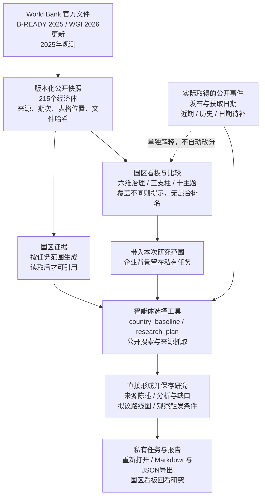
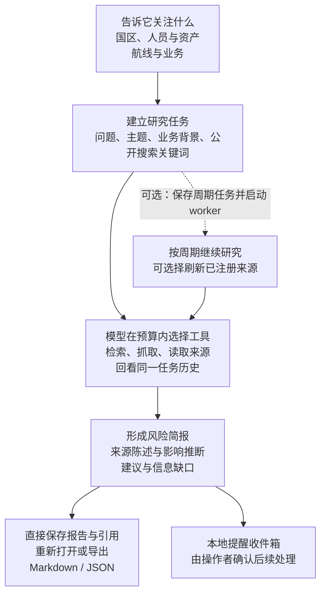
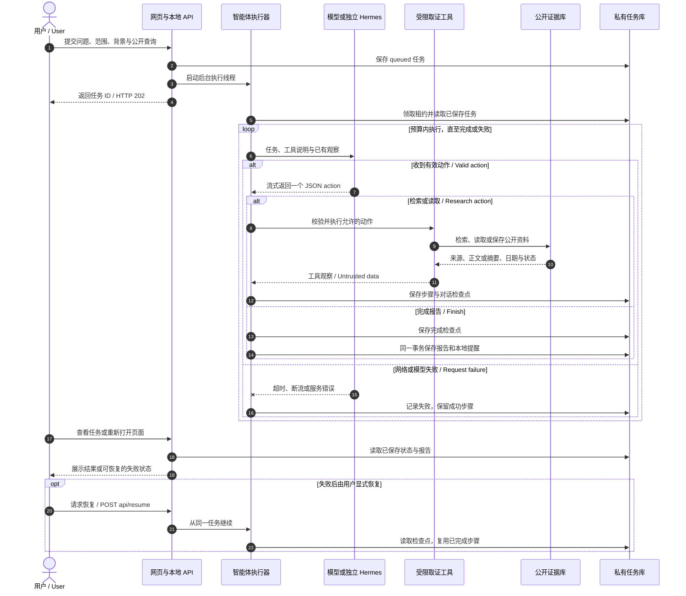
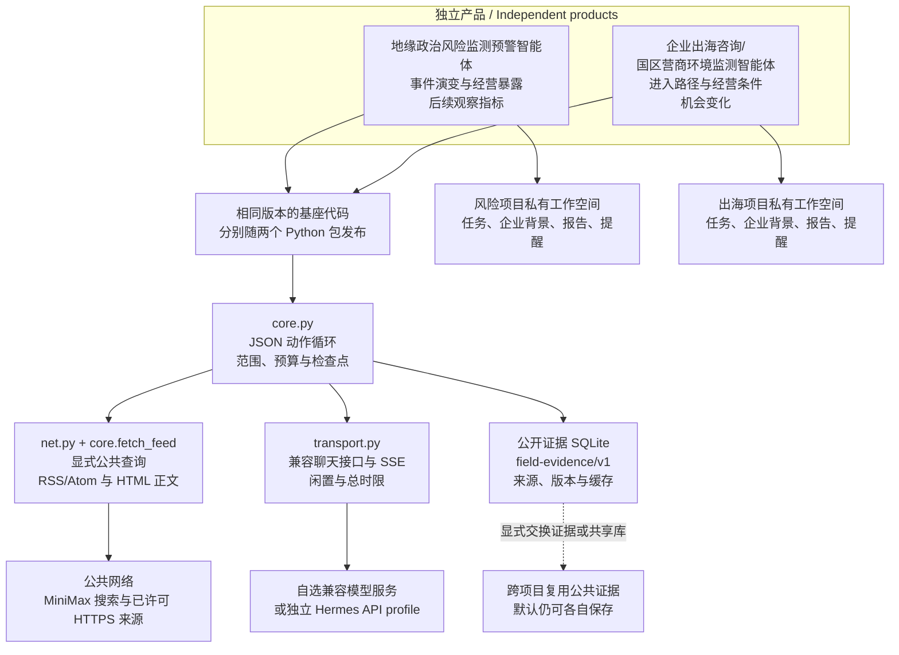

# 地缘政治风险监测预警智能体

从一个国际问题出发，查资料、理清事件与各方立场，形成带来源的分析，再接着跟踪会改变判断的新进展。

[English guide](README.md#english-guide) · [先跑示例](#先跑通一个示例) · [工作流程](#一次研究怎样完成) · [正式版本](https://github.com/workstonedai-collab/georisk-agent/releases/tag/v0.14.0) · [Windows 安装](docs/windows.md)

当前正式版本为 **v0.14.0**。项目仍处于 Alpha 阶段，可自行部署；离线演示不需要模型密钥，真实研究需配置模型与来源。

## 项目背景与开放范围

国际问题的资料往往并不少。新闻、声明、报告和论文散在不同地方，同一件事也可能有几种说法。真正费时间的是把它们放回时间和背景中：发生了什么，各方为什么这样做，不同解释各有什么依据，下一步出现什么变化，才值得重新判断。

这个项目把资料、分析和后续问题保存在同一个可以接续的研究任务里。你可以带着一个具体问题开始，也可以围绕某个国家、地区、国际组织或长期议题持续跟踪。智能体在你允许的范围内检索公开信息、阅读材料，整理来源陈述、分析判断与信息缺口，直接形成并保存报告。之后继续提问时，可以接着已有资料和判断往下做。

它面向国际关系、国际政治、区域国别、国际组织和全球治理研究者，也面向咨询公司、律所等专业服务从业者、国际记者、国际问题爱好者，以及有海外利益的企业和个人。研究一个议题、准备一篇报道、评估一项利益可能受到的影响，关注点各不相同；你可以按本次任务选择入口，研究和报道任务不必填写企业背景。

## 可以这样使用

**专题研究：围绕一个问题，把解释和依据展开。** 比如研究某个国际组织中的立场变化，可以让它梳理相关行为体、声明和事件顺序，比较材料所支持的解释，说明分歧在哪里、哪些问题还需要进一步找资料。这个入口适合研究讨论和专题准备；是否能覆盖所需文献，取决于实际接入和取得的资料。

**事件跟踪与报道准备：先看新增了什么，再看哪些仍待核实。** 围绕一次选举、一轮谈判或一项政策变化，你可以要求它整理时间线，保留原始声明与转述的归属，列出不同说法和进一步取材的问题。采访问题供后续取材使用，不代表已经完成采访或独立核实。

**利益影响与风险观察：把事件放回与你有关的处境里。** 新闻每天都有，难的是判断哪条与你有关：一项制裁是否涉及合作方，一次港口限制会不会影响交付，一场局势升级是否已经触及当地团队。提供相关人员、资产、航线、项目或其他利益后，可以围绕影响路径、关键条件和下一次观察信号展开分析。事件与某项业务的关联不明时，报告应保留这个条件。

## 把研究接着做下去

第一次配置时，可以在网页填写模型设置、单独测试连接，再选择要添加的官方来源。日常使用时，查看持续运行进程的最近心跳与检查记录；已保存报告可直接导出带标题、列表的可编辑 Word，不额外调用模型。原有 OfficeCLI 和 MCP 入口继续保留。[配置与日常使用](docs/setup-and-use.md)

报告和快报保存后，可以留下是否有用、是否重复或需要怎样纠正的反馈，再决定是否调整持续关注。“经验与技能”也能查看某个版本何时被带进后续任务、关联报告收到了什么反馈，便于决定继续使用、停用或回退。[反馈与技能记录](docs/feedback-and-skills.md)

研究做过几轮后，可以从项目页的研究档案找回报告、未解决的问题、已有判断和来源。知识库支持部分机构与术语的中英文别名匹配、发布日期筛选和匹配片段阅读；从报告打开引用时，仍使用当时的文件版本。另提供少量可选择登记的官方来源配置。[在一个项目里接着研究](docs/project-research.md)

例如，持续研究某个国际组织中的立场变化时，可以把历次声明、研究笔记和背景报告整理成一个知识库，选入当前任务，再结合允许检索的公开资料比较各方解释。报告保存后，把仍需观察的问题设为持续关注；新材料到来时，接着原来的问题研究，回看哪些依据或判断需要调整。

你提供的材料可以在“我的知识库”里按项目整理：上传文件、查看解析状态，再选择本次研究使用哪些资料。原件、版本与出处留在私有工作空间，更新资料后仍能追溯旧任务。

材料入库后，可以先试查内容，再决定本次研究使用哪些资料。引用保留文档版本与可取得的出处位置；替换材料后，已初始化的任务仍沿用原版本。扫描件需要另行处理，Office 的文字转换也不能代替对原件排版、表格和注释的阅读。

希望持续关注时，先保存监测方案，预览并确认范围、提醒标准和检查/汇总频率，再启动工作进程。事件风险、长期议题和经营机会分别设置；没有新增内容时保持安静。需要飞书等渠道时，可显式接入已有 Hermes 发送配置。

提醒标准可以围绕你的研究问题设置：关注哪些行为体、哪些声明或事件，什么变化值得重新研究，哪些消息只作背景。检查来源与汇总快报可以采用不同频率，也可以设置免打扰时段、首次只建立基线。规则模式按明确词项和来源筛选；需要按文字标准研判时，选择有预算的模型模式。方案、来源配置或外部接收位置发生变化后，需要重新预览并确认。

项目还可以按你的选择积累研究经验：本地整理有效步骤与纠正，或在独立额度内让模型提炼技能候选。技能保留来源任务与版本，可以启用、停用和回退；不会自动扩大工具权限或公开你的资料。[知识库、持续监测与技能学习说明](docs/continuous-research.md)

比如，你可以明确纠正“先区分原始声明与媒体转述，再比较解释”，让这条要求进入本项目的技能候选。默认由你选择版本启用；以后也能停用或回退。学习在报告保存后另行处理，本地整理不增加模型调用，模型提炼使用单独限额；它积累的是研究步骤与使用经验，不更新基础模型权重。

一次研究结束后，你可以回看报告、来源和工具记录，也可以补充本机资料，沿着尚未解决的问题继续查。研究记忆把来源陈述、假设、判断、拟议方案和你的决定分开保存，保留修订原因；旧判断供本次研究参考，新的输入优先。周期跟踪需单独启动工作进程，新进展和相关提醒先保存在本地，由你决定怎样使用。

成果可以保存为 Markdown、JSON，也可以通过可选的本地 OfficeCLI 导出成可编辑 Word，继续用于讨论或工作材料。已有 Word、Excel、PowerPoint 可通过可选文档适配器导入；转换保留文本及出处信息，复杂排版和表格仍需对照原件。接入自己的工具时，可使用默认只读的本地 MCP 接口。[研究记忆](docs/research-memory.md) · [办公资料与任务入口](docs/office-and-tasks.md) · [MCP 接入](docs/mcp.md)

如果你不熟悉编程，可以把这个仓库交给自己的 Agent，让它按说明部署，先跑无需密钥的演示，再带你配置模型、公开搜索和信息源。可以独立使用，也可以与[企业出海咨询/国区营商环境监测智能体](https://github.com/workstonedai-collab/market-entry-agent)交换公共证据。企业背景、研究任务和报告仍保存在各自的私有工作空间。

**开放范围与交流：** 国区评分配方、分项权重、贡献计算与通用研究步骤已公开。部分进一步的研究方法、专用提示词和相关知识内容暂未开源。如有需要或希望进一步交流，欢迎[联系作者](https://github.com/workstonedai-collab)或提交[项目 Issue](https://github.com/workstonedai-collab/georisk-agent/issues/new)；私人资料请勿直接发布在公开 Issue。

## 先看工作界面


上图展示国区看板。报告、来源和任务记录可在工作空间查看；它不代表对任意企业完成了研究。先用下面的演示查看保存的结果，样例数据范围见[公开示例](examples/README.md)。

## 先跑通一个示例

下面为 macOS / Linux 命令。Windows 可直接使用 Python，无需 WSL；请看 [PowerShell 安装与使用说明](docs/windows.md)，包括模型设置、中文路径、保存恢复、导出和常见问题。自动检查覆盖三个系统的 Python 3.11–3.13，并单独验证 Windows 独立环境安装。

```bash
git clone https://github.com/workstonedai-collab/georisk-agent.git
cd georisk-agent
python3 -m venv .venv
source .venv/bin/activate
python -m pip install -e .
georisk-agent demo
georisk-agent serve
```

浏览器访问 http://127.0.0.1:8711 。先查看已保存报告、证据和工具记录，再输入自己的研究任务。示例无需密钥，不调用大模型；资料和分析均清楚标为虚构情景或规则演示。

报告会说明事件怎样变化、可能影响哪项业务，以及接下来观察什么。自然表达的要求在首次写作时应用，来源页可查看最近获取和失败情况。详见[报告写作与案例验证](docs/report-quality.md)。

研究任务现在可保存子问题、原文摘录、假设和下一步，恢复后继续使用。可另行填写公开词范围，允许智能体在预算内组合后续检索。本机文本、表格与可选的 PDF 文本资料也可导入；PDF 需另配提取工具，不含 OCR。基础安装仍无新增运行依赖，详见[研究进展与取材说明](docs/research-state.md)。

新增三组真实历史事件案例：Rubymar沉船与已订舱设备交付、True Confidence事件与不同经营暴露、巴拿马运河限流调整与预约安排。每次明确选择一组，保留智能体直接生成的原稿和运行回执，按“读得顺、分析有依据、建议能执行”检查；企业条件为虚构，报告不作人工改写后冒充原稿。使用方法见[案例验证说明](docs/report-quality.md#用几组真实事件检查直接生成的原稿)。

## 国区看板：从背景到行动

先选国家，再看哪些变化值得研究。新增看板覆盖 **215 个经济体的治理分项**，其中 **101 个有完整双源营商研究参考**。你可以查看六维治理、营商三支柱与十个主题，比较最多五个国区，核对来源和数据期次，再带着所选国家发起研究。

年度结构数据、近期公开事件和已保存的国区研究放在同一条使用路径里。企业出海研究可以展开宏观、行业、竞对与进入路径，并形成分阶段行动计划；地缘风险研究可以保留经营暴露、观察条件和下一步核查。报告与来源一并保存，支持重开和导出。

指数采用本项目的 **60% B-READY + 40% WGI** 研究拟合。只有治理数据的国区会单独标出，缺失不补零；不把事件自动折算成涨跌，也不输出混合口径国家排名。它是本项目的研究参考值，计算结果可复核；不代表官方综合指数或已校准的国区风险预测。数据为 B-READY 2025 与 WGI 2026 更新的 2025 年观测，快照为 2026-10-21。

[国区看板与计算说明](docs/country-dashboard.md) · [数据署名与许可](LICENSE-DATA.md)




## 一次研究怎样完成

从一个具体问题开始。模型在任务范围和预算内选择工具，读取材料后直接形成报告；来源、执行步骤和结果会留下记录。



周期执行需要单独启动 worker。模型每次选择需要使用的工具，报告按任务保存；本地提醒的确认只改变提醒状态。

<details>
<summary>展开查看：任务时序与技术路线</summary>

### 从提交到保存的时序

网页先返回任务 ID，研究在服务端执行。每个工具步骤完成后保存进度；关闭页面后可以回来查看。模型或网络失败时，可以显式恢复原任务。



模型接收到任务、企业背景和选取的证据；公开搜索只发送用户明确填写的查询，或在获准公开词范围内组合的查询。工具返回的网页内容按资料处理，不作为执行指令。

### 两个项目怎样共用基座

两个仓库各自安装、运行和发布，共用相同版本的基础代码及 `field-evidence/v1` 证据格式。需要跨项目复用时，可以显式交换公共证据包或选择同一公共证据数据库。



图中的共同基座是分别随两个项目发布的代码。企业背景、任务、报告和提醒仍保存在各自私有工作空间；资料会按用户配置发送给模型服务。

</details>

## 项目持续跟踪

一次研究结束后，事件往往还在发展。你可以在“项目持续跟踪”里记下关注的人员、资产、航线或业务，把同一事件的来源和新进展接着保存。严重程度、状态、信息依据或业务影响改变时，项目会留下本地提醒；只补充摘要或重复来源不会反复提醒。

打开项目后，先添加“关注对象”，再录入事件，或点“继续研究这个项目”补充资料。提醒会保留资料日期、关联业务和下一次关注事项，也可以记录已阅、有用、无关或已处理。“对比本地资料”只比较已有记录；获取新信息仍需研究、刷新来源或启动已配置的周期任务。

[操作说明与公开案例](docs/product-workflow.md) · [案例资料](examples/public-project-case.json)

### 把事件放回业务里看

登记航线、港口、供应商和项目的关联编号、重要程度与关键日期后，可以把事件与业务逐项对照，查看关注顺序的理由。确认过的别名和重复档案可合并，原始历史仍保留；业务条件改变后可以重新检查。详见[从事件到业务提醒](docs/decision-paths.md)。

## 接着同一个项目继续研究

给相关任务填写同一个项目 ID，可以在换个问法后召回旧报告，并保留你录入的项目资料。本次输入优先于旧资料，企业资料与历史分析有明确区分；来源仍须在本次运行读取后才能引用。

```bash
georisk-agent memory-set fictional-research product "虚构演示：设备出口"
georisk-agent demo --project fictional-research
georisk-agent run examples/project-mission.json --engine demo
georisk-agent skills
```

网页新增项目资料、技能选择和研究暂停/取消入口。长资料分段读取，旧工具结果保存在本地；模型请求有上下文字符预算，并保留调用、耗时和服务已报告用量。操作、隐私与恢复边界见[共用内核使用说明](docs/kernel.md)。Windows 在独立环境中通过相同模块入口使用。

### 研究记忆可以接续到下一次提问

同一项目的来源陈述、假设、判断和拟议方案会分开保存，下一次提问按相关性带入，并保留相关的反对依据。操作者可以记录自己的决定、修订原因或移出旧记忆；恢复任务沿用原快照。本次输入始终优先，历史判断不会自动变成新的证据。详见[研究记忆与上下文](docs/research-memory.md)。

## 接入真实研究

配置你自己的模型服务，导入有权使用的证据包，并以 `--engine model` 运行任务。可以使用独立 Hermes Profile 的兼容接口，详见 [Hermes 接入](docs/hermes.md)。模型模式会把本任务、企业背景、检索结果与相关历史摘要发送到你配置的服务；不会扫描其他项目或自动读取密钥。

当前公开版支持公开证据导入、RSS/Atom 来源刷新、显式公开关键词搜索，以及已注册或搜索发现的 HTML 网页抓取。信息源的国区与主题标签由操作者配置；来源陈述不会自动被标为已核实事实。

## 可以从这些问题开始

| 你的问题 | 任务需要的输入 | 希望得到的结果 |
|---|---|---|
| 一条航线的局势变化会不会影响交付？ | 航线、相关国区、运输安排、研究时点与允许检索的公开关键词 | 事件进展、可能的影响路径、待补资料与后续观察条件 |
| 一项新限制是否值得重新检查合作方？ | 涉及国区、产品或业务、政策原文与具体问题 | 适用范围的研究线索、来源依据和需要专业核查的事项 |
| 哪些变化需要当地团队进一步确认？ | 人员与资产所在国区、关注主题和已有公开证据 | 与本次任务相关的风险说明、信息缺口和下一步检查清单 |

这些是示例问题，不是已验证的事件判断。使用时填写自己的时间和范围，并提供获准使用的来源。仓库中的[虚构任务](examples/mission.json)用于熟悉操作；[公共国区数据任务](examples/public-data-mission.json)用于读取真实公开统计，均不包含客户资料。

## 公开的研究步骤

风险研究按“事件与演变 → 经营暴露 → 国区结构背景 → 观察与应对”展开。先弄清发生了什么、来源何时发布，再分析人员、资产、航线或订单可能怎样受到影响。年度治理与营商指标提供背景；后续观察条件说明什么变化可能改变判断，以及接下来核查什么。

`research_plan` 提供公开研究提纲；报告可以保存 `watchpoints` 和拟议行动阶段。它们是后续研究与决策的参考，不代表已执行应对。自定义任务可通过 `output_sections` 要求包含 `watchpoints` 或 `roadmap`。

## 使用自己的研究说明

公开版包含通用角色说明、公开研究提纲和报告格式。部署者可通过 `AGENT_INSTRUCTIONS_FILE` 显式加载自己的 UTF-8 说明文件（最多 24KB），放在仓库之外。其内容会发送到所配置的模型，并保存在本地任务检查点中。恢复任务时沿用原检查点；需要应用新说明时建立新任务。[模型、搜索与数据边界](docs/live-research.md)。

## 可以持续做什么

- 研究：模型自主选工具，围绕任务收集和阅读证据，再保存成果。
- 记忆：以项目 ID 关联研究，回看私有项目资料、业务状态和相关历史报告。
- 监测：保存关注周期，由单独启动的 worker 持续执行。
- 交付：直接保存报告，导出 Markdown/JSON，产生待确认的本地提醒。
- 恢复：保留已完成步骤，模型或网络失败后继续未完成部分。

风险研究重点是事件演进、影响传导、企业暴露和升级或缓和信号；严重性、证据可信度和客户相关性分别分析。

## 两个项目怎样互通

与 [market-entry-agent](https://github.com/workstonedai-collab/market-entry-agent) 共用证据契约和相同版本的内核，各自独立安装、运行、发布。公共证据可以显式共享，企业资料、任务和报告保存在各自私有空间。详见 [共同底座](docs/shared-core.md)。

## 工具接入与办公资料

### 接入自己的工具，按问题展开研究

可通过[本地 MCP 服务](docs/mcp.md)读取已有任务、报告和项目记录；显式允许后，客户端才能创建或恢复研究任务。也可连接自己配置的公共 MCP 搜索服务，只发送允许的公开词。[可选研究分支](docs/research-depth.md)让不同前提分别取材，进度随任务保存，共用原来的时间和调用预算。文档技能支持声明输入、输出与工具依赖，仍不执行脚本或扩大权限。

### 把资料带进来，把研究接着用

开始研究时，可以选择专题研究、事件与报道准备、利益观察，或出海项目的市场选择、交易评估、经营跟踪。需要办公资料时，可选 MarkItDown 导入本机 Word、Excel 和 PowerPoint；已保存的完整报告可通过本地 OfficeCLI 导出为可编辑 Word，不额外调用模型。配置方式、已支持的范围与限制见[办公资料与任务入口](docs/office-and-tasks.md)，采用了哪些项目见[集成取舍](docs/integration-references.md)。

## 当前交付边界

当前为单操作员自托管 alpha，包含命令行、可操作网页、数据与模型接口、容器配置和自动化检查。GitHub 发布提供源码和版本，不等于已经托管一个全天候在线服务。当前不包含商业多租户、完整实时覆盖或已校准国区指数。外部快报需显式配置 Hermes 目标并确认启用，默认只保存到本地。

## 让你的 Agent 帮你部署

把仓库链接和下面这段话交给你的 Agent：

> 请先阅读 README 和部署说明，在独立目录安装这个项目，运行离线演示并打开本地网页。演示通过后，带我配置我选择的模型服务和公开信息源；需要搜索时，单独让我填写允许发送的公开关键词。请不要读取其他项目的密钥或企业资料。最后帮我跑一个自己的任务，确认报告已保存并可以重新打开。


## 版本与验证记录

[当前正式版本 v0.14.0](https://github.com/workstonedai-collab/georisk-agent/releases/tag/v0.14.0) · [完整更新记录](RELEASE_NOTES.md) · [报告案例与实际限制](docs/report-quality.md)

这几轮更新分别补上了资料进入研究、研究接到日常工作，以及后续持续使用的环节：

| 更新 | 使用时有什么变化 | 说明 |
|---|---|---|
| v0.14.0：接着研究与日常使用 | 研究档案、引用版本、明确反馈、技能使用记录、网页配置与直接 Word 导出 | [配置与使用](docs/setup-and-use.md) |
| v0.13.0：知识库、持续关注与经验技能 | 上传资料建库；预览并确认监测；选择是否积累、启用和回退私有技能 | [设置、恢复与限制](docs/continuous-research.md) |
| v0.12.0–v0.12.1：办公资料与任务入口 | 按本次问题选择任务；可选导入 Office 文件、导出完整 Word 报告；修复 Windows 测试清理时的文件占用 | [办公资料与使用方式](docs/office-and-tasks.md) |
| v0.11.0：工具接入与分别取材 | 自有客户端通过 MCP 读取研究；显式开启后可运行任务；不同子问题共用原任务预算 | [MCP](docs/mcp.md) · [研究分支](docs/research-depth.md) |

v0.13.0 的安装回归走过建库、报告保存与重开、监测确认和经验生成，跨平台检查继续覆盖 macOS、Windows 与 Linux。新模型分支和 Hermes 发送回执使用脚本替身验证；真实模型的报告案例与具体限制仍见上面的案例说明。

<details>
<summary>展开 v0.11.0 的业务路径与验证记录</summary>

## v0.11.0：把事件接到具体业务上

[正式版本与安装包](https://github.com/workstonedai-collab/georisk-agent/releases/tag/v0.11.0)已发布。这个版本可以接着跟进同一个事件，把后续消息放回你关注的航线、港口、供应商或项目里看。

例如，一条航线出现新情况，你可以先登记业务对象、重要程度和交付日期，再关联有来源支持的事件。项目会保留前后变化，说明提醒为什么与你有关、哪些事项值得先看。双方填有明确对象编号时，按编号交集匹配；缺少编号时会注明只是国区或主题相关。确认过的事件别名和重复档案可以合并，原有记录仍可回看。详见[从事件到业务提醒](docs/decision-paths.md)。

下一次继续研究时，来源陈述、假设、判断和拟议方案会分别保存，按当前问题带入相关内容，也保留相关的反对依据。你的决定单独记录，可以查看修订原因和历史；本次输入优先于旧资料。研究工作表还会留下读过的原文摘录、待解决的问题和下一步，中断后可以接着做。[研究记忆](docs/research-memory.md) · [研究进展与取材](docs/research-state.md)

需要接到自己的工具里时，可以启用默认只读的[本地 MCP 接口](docs/mcp.md)；允许创建或恢复任务须另行显式开启。一个问题涉及几条线索时，可选[按问题分别取材](docs/research-depth.md)，仍共用同一任务的时间和调用预算。公开检索只使用你明确允许的查询或词项，企业背景不拼入搜索词。

这个版本用 MiniMax 跑过 Rubymar 历史事件与虚构业务条件，检查了直接生成的报告、业务关联和保存后重开；也遇到格式问题后从原始返回内容恢复。原稿没有人工润色，实际结果与限制见[案例验证说明](docs/report-quality.md#v0110-产品路径验收)。

</details>
