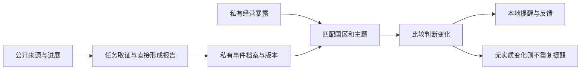

# 项目持续跟踪 / Product workflow guide

v0.6.0 在原研究、看板和报告功能之外增加私有业务项目。项目记录、历史版本、提醒、画像和计划只保存在私有任务库；公共证据库仍只承载显式导入或取得的公开资料。单操作员、自托管，不自动向外发送消息。

## 从网页开始

1. 按原安装说明启动服务，打开“项目持续跟踪”，输入稳定的项目 ID，再点“打开项目”。不同客户使用不同工作空间。
2. 选择要新增的记录，填写表单并保存。后续从记录卡片的“查看与修改”更新；保存时检查原版本，冲突后先重新打开记录。
3. 用“围绕本项目继续研究”带入项目 ID 和技能。该按钮带入项目国区、主题并清空上一项任务背景与公开查询；确认问题并补充本次要求及允许发送的公开关键词。模型模式会接收所选项目的私有资料，公开搜索仍只接收明确的公共查询。
4. 研究直接保存。符合合同的拟议业务更新与报告在同一事务保存；如果操作者已修改同一记录，报告保留，更新显示为待重新对照，不覆盖操作者资料。
5. “检查保存资料的变化”只检查本地已保存资料，不刷新来源。真实新资料需通过原有取证工具、导入、来源刷新或研究取得。项目页展示本地提醒，原研究提醒收件箱继续保留。

下方的记录编号用于关联事件、选项、假设和阶段。使用字母、数字、点、下划线或连字符，最多64字符。源码中没有客户专用配置；界面导出的私有项目文件应留在仓库之外。

## 命令行与 PowerShell

```bash
georisk-agent project equipment-asean
georisk-agent project-save equipment-asean my-command.json
georisk-agent project-history equipment-asean KIND RECORD_ID
georisk-agent project-check equipment-asean
georisk-agent run examples/project-mission.json --engine model --project equipment-asean --skill project-continuity
```

将 `georisk-agent` 换成本项目命令。`my-command.json` 为 UTF-8 JSON：

```json
{
  "kind": "KIND",
  "id": "stable-record-id",
  "expected_revision": 0,
  "data": {}
}
```

新增记录使用版本0。更新已有记录时填当前 `revision`，字段填写完整的新版本；内容相同的重复写入保持原版本。每个项目每种业务记录最多100个，运行收据、游标和提醒各最多5,000个；版本历史接口每次返回最近100个版本，不删除旧报告。适合有界的研究项目，达到容量上限时应归档工作空间并另建项目。

Windows 不需激活环境或改变执行策略：

```powershell
& ".\.venv\Scripts\python.exe" -m georisk_agent project equipment-asean
& ".\.venv\Scripts\python.exe" -m georisk_agent project-save equipment-asean .\my-command.json
& ".\.venv\Scripts\python.exe" -m georisk_agent project-check equipment-asean
```

## 智能体如何使用项目

`project_state` 返回本次任务开始时固定的业务目录与产品合同；传入 `kind` 和 `id` 可读取某一条完整记录，较长结果可用 `read_result` 分段查看。失败恢复继续使用原快照；本次用户输入优先。当前私有业务状态不进入 `as_of` 历史任务，历史报告不能修改当前业务项目。

模型可在 `finish.report.project_update.commands` 中提交合同允许的记录。来源必须在本任务读取并列在报告引用中，记录还检查国区、主题、关联对象和版本。它不能修改操作者画像、暴露、反馈或决策，也不能替操作者确认假设、选择方案或声明工作完成。结构和引用检查不等于独立事实审查。

项目摘要不会自动变成公共事实。私有业务条件、公开来源陈述、分析、拟议计划和操作者进度有各自的来源标记。只有人工录入或模型拟议的分类，不声称来源已独立证实。

## 可复现的公开历史案例

```bash
python scripts/verify_public_case.py
python scripts/verify_public_case.py --workspace ../georisk-agent-historical-case-workspace
```

指定的目录必须为空；该脚本不会往正在使用的客户工作空间写入案例。脚本使用本项目实际安装的代码、真实公开资料的自写摘要、虚构业务条件和替身模型动作，验证完整保存、重开、项目更新和去重路径。无需密钥，也不调用付费模型。它验证流程，不代表真实模型自行调查的质量、预测准确率或实际企业结果。

原始公开来源及日期保存在 [案例文件](../examples/public-project-case.json)。摘要不是对原网站正文或图像的整份复制；正文、地图与第三方数据版权仍归原权利人。当前取回的历史公告不能证明系统当时已获取信息。案例按资料发布顺序回放，不作为当前预警或当前产品合规结论。

可选 `--live` 会重新请求案例中列出的原始来源，记录 HTTP 状态、文件大小和原始响应 SHA-256。这个检查仅证明取得响应，内容语义仍需对照来源；不可用来源会逐项记入凭证，`live_sources_complete=false` 时不声称全部取得。CI 使用固定公开摘要，不访问外部来源。可用 `--output receipt.json` 保存回放凭证。

## 接口、升级与验证

新增本地接口沿用既有令牌、Host 和 Origin 检查：`GET /api/project?project_id=...`、`GET /api/project/history?project_id=...&kind=...&id=...`、`POST /api/project`（project_id与command）、`POST /api/project/check`（project_id）。它们不是 MCP，也不是商业多租户接口。

升级前停止自己的 server/worker，备份完整私有工作空间，再安装新包。首次打开只增加 `business_records` 表；不改写旧任务、证据编号和已完成报告。既有 worker 继续按原任务执行；新项目任务完成时，会检查保存的业务资料并记录结果。只有启动 worker 才有周期运行，GitHub 发布不等于全天候托管。

```bash
python -m unittest discover -s tests -v
python scripts/verify_kernel.py
python scripts/verify_portability.py
python scripts/verify_public_case.py
python scripts/check_public_release.py
python scripts/check_core.py
```

All existing CLI/browser/report/country functions remain available. The packages remain standard-library only and independently installable on Windows, macOS and Linux. CI runs Python 3.11–3.13, clean Windows PowerShell installation and a container demonstration. Private state is additive; original saved reports and evidence IDs are preserved. MCP, external delivery, provider-backed quality evaluation and unrestricted semantic event clustering are not included in this batch.

## 事件、暴露与提醒

先新增“经营暴露”，给它设置国区、主题、首次提醒最低严重程度及启用状态。国区与主题同时填写时，两组条件都要匹配。暴露可以代表人员、资产、航线或业务方向；名称与说明只在私有工作空间保存，不自动发给搜索服务。

再新增“事件”，填写主体、地点、发生日期、进展发布日期、来源陈述、严重程度、信息依据、状态、可能影响、下一次检查事项及证据编号。`id=auto` 按标准化主体、地点与发生日期归并。跨来源使用相同主体、地点和日期可进入同一档案，标题、摘要或新增URL不会另造一个事件；它不做任意文本的自动语义聚类。主体歧义需要操作者或研究过程明确处理。

同一事件的新版本保留来源集合。事件身份不允许改成另一个主体或日期。新增来源不自动升级为独立交叉验证；严重程度、信息依据和企业相关性分别展示，不输出未经校准的概率。支持 tracking（跟踪）、escalated（升级）、easing（缓和）、closed（结束）。

检查保存事件时，运行器比较严重程度、状态、信息依据、影响与下一次检查条件。同一暴露对同一判断只产生一次提醒；只改摘要或补相同判断的来源不会重复提醒。曾提醒的事件缓和、结束或再次发生实质变化时，会保留前一次判断并产生更新。停用暴露后不再形成新提醒。可记录已阅、有用、无关或已处理；反馈不会自动改写方法或信息可信度。

目前的提醒在项目页本地保存，不自动通知外部账号。来源的发布日期会随提醒展示；旧事件不是当前告警。检查结果明确标为 `saved_project_events_only` / `source_refresh=not_performed`，安静不等于全网没有事件。要持续取得新资料，应配置来源、研究任务和显式运行的 worker。



本项目案例回放 UNOSAT 2024-02-29 初步卫星评估与 IMO 2024-03-04 声明，验证 Rubymar 同一事件从可能油膜信息到沉船风险进展的更新。虚构红海航线收到初次和升级提醒；无关市场和重复检查不新增提醒。影响与分级是演练分析，不是原机构对虚构企业损失的判断。

The event key groups normalized subject/place/day; it is deliberately explainable and conservative. Private exposure matching uses configured country/topic conditions, not a model-generated probability. Alerts retain the source dates and previous assessment, and are local records with operator feedback. Public historical sources demonstrate progression and repeat suppression with fictional exposure, not present-day warning accuracy.
